<picture>
  <source media="(prefers-color-scheme: dark)" srcset="./assets/header-dark.svg">
  <source media="(prefers-color-scheme: light)" srcset="./assets/header-light.svg">
  
</picture>

I build **LLM systems**, **AI agents** and the backends behind them: agents that run for **12 hours** without
losing their place, search that mixes **BM25 with vectors**, and APIs that went from **10 seconds to 200 ms**.

<picture>
  <source media="(prefers-color-scheme: dark)" srcset="./assets/impact-dark.svg">
  <source media="(prefers-color-scheme: light)" srcset="./assets/impact-light.svg">
  
</picture>

```text
now       ai & backend engineer @ inctec — ai engine, mcp agents on temporal,
          multi-tenant identity for an enterprise aiops platform
building  enterprise rag — bm25 + pgvector hybrid search with reranking
studying  b.sc. ai solutions & applications, pdp university (2026)
```

### Selected work

**[Enterprise RAG](https://samandareo.uz/projects)** — hybrid search in Postgres, reranked before the LLM answers.
```text
pdf → pymupdf4llm → bm25 + tsvector + bge-m3 (pgvector) → bge-reranker-v2-m3 → llm
```

**[UzPlagiat](https://github.com/samandareo/uzplagiat)** — plagiarism detection for Uzbek, a low-resource language.
```text
paper → tahrirchibert fine-tuned with sbert → faiss → similarity report
```

**[Arif Mart Ask AI](https://samandareo.uz/projects)** — a shopping assistant that knows the catalog and stays on topic.
```text
question → guardrails → rag over products → function calling → structured answer
```

### Stack, in orbit

<picture>
  <source media="(prefers-color-scheme: dark)" srcset="./assets/orbit-dark.svg">
  <source media="(prefers-color-scheme: light)" srcset="./assets/orbit-light.svg">
  
</picture>

### Commits, as stars

<picture>
  <source media="(prefers-color-scheme: dark)" srcset="https://raw.githubusercontent.com/samandareo/samandareo/output/commit-stars-dark.svg">
  <source media="(prefers-color-scheme: light)" srcset="https://raw.githubusercontent.com/samandareo/samandareo/output/commit-stars-light.svg">
  
</picture>

> The constellation in the header is Ulugh Beg's sextant: Samarkand, 1420, where he catalogued
> 1,018 stars by hand. His data was the sky. Mine is above, redrawn every night.

<details>
<summary>stats</summary>
<br>

<picture>
  <source media="(prefers-color-scheme: dark)" srcset="https://github-readme-stats.vercel.app/api?username=samandareo&show_icons=true&hide_border=true&bg_color=0A0A0A&title_color=EDEDED&text_color=A1A1A1&icon_color=EDEDED">
  
</picture>
<picture>
  <source media="(prefers-color-scheme: dark)" srcset="https://github-readme-stats.vercel.app/api/top-langs/?username=samandareo&layout=compact&hide_border=true&bg_color=0A0A0A&title_color=EDEDED&text_color=A1A1A1">
  
</picture>

</details>

---

[samandareo.uz](https://samandareo.uz) · [linkedin](https://www.linkedin.com/in/samandareo) · [telegram](https://t.me/samandareo) · [email](mailto:sam.abdugafforov@gmail.com)
