<picture>
  <source media="(prefers-color-scheme: dark)" srcset="./assets/header-dark.svg">
  <source media="(prefers-color-scheme: light)" srcset="./assets/header-light.svg">
  
</picture>

I build **LLM systems**, **AI agents** and the backends behind them.

```text
now       ai & backend engineer @ inctec — ai engine, mcp agents on temporal,
          multi-tenant identity for an enterprise aiops platform
building  enterprise rag — bm25 + pgvector hybrid search with reranking
studying  b.sc. ai solutions & applications, pdp university (2026)
```

### Selected work

- **[Enterprise RAG](https://samandareo.uz/projects)** — hybrid search in Postgres: BM25, pgvector and a reranker before the LLM answers.
- **[UzPlagiat](https://github.com/samandareo/uzplagiat)** — plagiarism detection for Uzbek papers, a low-resource language, with SBERT and FAISS.
- **[Arif Mart Ask AI](https://samandareo.uz/projects)** — shopping assistant with RAG, function calling and prompt-injection guardrails.

### Stack

```text
ai        openai · anthropic · litellm · mcp · rag · pgvector · faiss · transformers
backend   python · fastapi · temporal · kafka · postgres · mongodb · redis · clickhouse
frontend  typescript · react · next.js · react native · flutter
```

### Commits, as stars

<picture>
  <source media="(prefers-color-scheme: dark)" srcset="https://raw.githubusercontent.com/samandareo/samandareo/output/commit-stars-dark.svg">
  <source media="(prefers-color-scheme: light)" srcset="https://raw.githubusercontent.com/samandareo/samandareo/output/commit-stars-light.svg">
  
</picture>

<details>
<summary>stats</summary>
<br>

<picture>
  <source media="(prefers-color-scheme: dark)" srcset="https://github-readme-stats.vercel.app/api?username=samandareo&show_icons=true&hide_border=true&bg_color=0A0A0A&title_color=EDEDED&text_color=A1A1A1&icon_color=EDEDED">
  
</picture>
<picture>
  <source media="(prefers-color-scheme: dark)" srcset="https://github-readme-stats.vercel.app/api/top-langs/?username=samandareo&layout=compact&hide_border=true&bg_color=0A0A0A&title_color=EDEDED&text_color=A1A1A1">
  
</picture>

</details>

---

[samandareo.uz](https://samandareo.uz) · [linkedin](https://www.linkedin.com/in/samandareo) · [telegram](https://t.me/samandareo) · [email](mailto:sam.abdugafforov@gmail.com)
